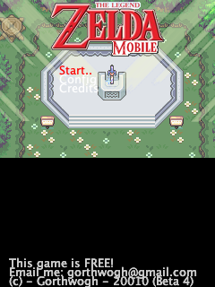
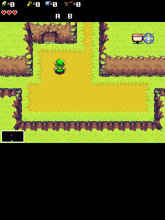
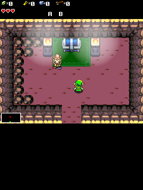
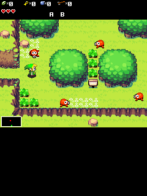

# Zelda Mobile

A Zelda fan game from the days of Java phones, brought back to the Mac and browser.

Play as Link, explore forests, caves and dungeons, discover hidden entrances,
and collect familiar equipment such as the sword, bow, boomerang and hookshot.
Find the Triforce pieces and challenge the bosses on the way to Ganon.

## Screenshots

| The adventure begins | Explore the overworld |
| :---: | :---: |
|  |  |
| **Discover caves and treasure** | **Face familiar enemies** |
|  |  |

## Start playing

Open **Zelda Mobile.app** in Applications, or your local build at
`dist/Zelda Mobile.app`. Press **Z** on the keyboard or **A** on an Xbox
controller, then choose one of the three save slots.

You can play with the MacBook keyboard, an Xbox controller, or switch between
them while playing. Connect the controller before or after opening the game.
The game pauses when you switch to another app.

If you are starting from the source code, follow the [build guide](docs/DEVELOPMENT.md).

## Controls

### Play in a browser

The [web version](https://carlosmoran97.github.io/zelda-mobile/) runs the same
Rust game through WebAssembly. It is designed for portrait mobile browsers, with
a D-pad, A/B buttons, Menu, and the game's current command buttons beneath the
screen. Hold a direction and an action together to move and use equipment.
Keyboard controls below also work in the browser.

Tap **Play** to begin and enable audio. The instrument bank downloads separately,
so you can play while sound loads. **Sound** toggles audio. Switching apps pauses
the game; tap **Resume** when you return.

The three web save slots and settings stay in this browser on this device.
Explicit saves and backgrounding checkpoint your progress. Clearing site data
removes these saves; browser and native saves are separate.

### Native controls

| Action | Keyboard | Xbox controller |
|---|---|---|
| Move / navigate | Arrow keys | D-pad or left stick |
| Primary action / confirm | Z | A |
| Secondary action / back | X | B |
| Inventory / game menu | Enter | Menu / Start |
| Left / right command at the bottom of the screen | Q / W | LB / RB |
| Remap controls | F2 | View / Back |

Use **Escape** to go back, **F11** for fullscreen, and **F12** to take a screenshot.
To change your controls, open **F2 / View**, select an action, and press **Z / A**
to assign a new key or button. **Tab / Y** switches between keyboard and controller
bindings; **R** restores the defaults.

## Save your adventure

Choose **SAVE** in the inventory or **Save & exit** from the menu. Closing the
game window also saves your active character. Three save slots let you keep
separate adventures.

Your saves, control preferences and screenshots are stored in
`~/Library/Application Support/Zelda Mobile/`.

## About the game

The original **Zelda Mobile beta 4** was created by **Gorthwogh**. This version
keeps its original artwork, music, world and credits, including the beta's
unfinished content and quirks.

[Credits and licenses](THIRD_PARTY.md) · [Building and contributing](docs/DEVELOPMENT.md) · [Porting notes](reference/PORTING.md)
